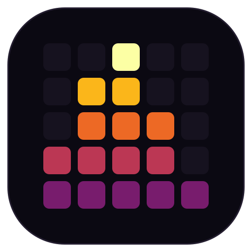
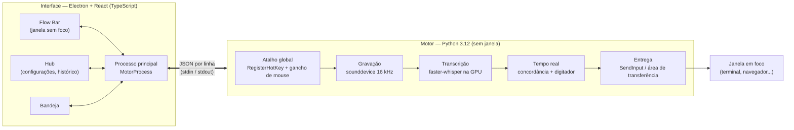

<p align="center">
  
</p>

<h1 align="center">GilleVoz</h1>

<p align="center">
  <b>Ditado por voz para Windows, 100% local.</b><br>
  Você fala, o texto aparece onde o cursor estiver — no terminal, no navegador, no chat.<br>
  Sem assinatura, sem nuvem: a transcrição roda na própria placa de vídeo.
</p>

<p align="center">
  
  
  
  
  
  
</p>

> **English summary** — GilleVoz is a local, privacy-first voice dictation app for Windows. A windowless Python
> engine records the microphone and transcribes it on the GPU with faster-whisper (`large-v3-turbo`), then types
> the text into whatever window has focus — optionally *while you speak* (real-time mode). An Electron + React UI
> provides a floating "Flow Bar" that never steals keyboard focus, a settings Hub and a tray icon. It ships with an
> Inno Setup installer that bundles its own embeddable Python. 185 Python tests + 62 UI tests.

---

## Por que existe

Eu passo o dia conversando com agentes de IA (Claude Code, Codex) e escrevendo textos. **Falar é 3 a 4 vezes mais
rápido que digitar**, mas as ferramentas de ditado boas são pagas por mês e mandam a sua voz para servidores de
terceiros.

O GilleVoz faz o mesmo trabalho **no meu próprio computador**: o modelo de transcrição roda na GPU (uma RTX 4060), o
áudio nunca sai da máquina e não existe mensalidade. A experiência foi pensada no nível dos apps comerciais de
ditado (como o Wispr Flow): barra flutuante, atalho global, histórico, dicionário pessoal — com identidade visual
própria.

## O que ele faz

| | |
|---|---|
| **Atalho global** | `Ctrl+Shift+Espaço` em qualquer programa: aperta para gravar, aperta de novo para parar. Também funciona **segurando** um atalho (inclusive o **botão lateral do mouse**). `Esc` cancela. |
| **Tempo real** | No modo mãos livres, as palavras vão sendo digitadas **enquanto você fala** — e uma palavra já digitada nunca é apagada. |
| **100% local** | faster-whisper `large-v3-turbo` na GPU (CUDA). 19 s de fala viram texto em ~0,6 s. Sem placa NVIDIA, cai para a CPU automaticamente. |
| **Não estraga sua área de transferência** | Quando cola, salva tudo o que estava copiado (inclusive imagens e arquivos) e restaura depois. O texto colado não entra no histórico do `Win+V`. |
| **Flow Bar** | Pílula flutuante embaixo da tela, com um "termômetro de LED" que acende conforme o volume da voz. **Nunca rouba o foco** da janela onde você está escrevendo. |
| **Hub** | Estatísticas (palavras, ditados, palavras por minuto, sequência de dias), histórico por dia, dicionário com trocas ("cloud code" → "Claude Code") e atalhos de texto (fala um gatilho, cola um texto pronto). |
| **Instalador** | `GilleVoz-Setup.exe` (~120 MB) instala sem pedir administrador, traz o próprio Python, tem "Reparar" e desinstala mantendo seus dados. |

## Como funciona



São **dois programas conversando**:

- **O motor (Python)** faz o trabalho pesado e não tem janela nenhuma. Ele escuta o atalho global, grava o microfone,
  transcreve na GPU e entrega o texto na janela que está em foco. Ele recebe comandos e manda eventos como
  **uma mensagem JSON por linha** pela entrada/saída padrão — um protocolo simples, fácil de testar e de depurar.
- **A interface (Electron)** é a cara do app. O processo principal abre o motor como processo filho, **vigia e
  reinicia** se ele cair (até 3 vezes por minuto; depois mostra o motivo na barra), e repassa os eventos para as
  janelas. As janelas da barra e do menu são criadas com `focusable: false` e abertas com `showInactive()` — é
  isso que garante que clicar na barra não tira o cursor do lugar onde você está escrevendo.

### O desafio do tempo real

O Whisper não foi feito para streaming: cada leitura do mesmo áudio pode mudar as últimas palavras. Se o app
digitasse tudo o que lê, ia ficar apagando e reescrevendo texto na janela do usuário. A solução:

1. A cada ~0,8 s o motor transcreve o áudio novo com **marcação de tempo por palavra**.
2. Uma palavra só é **confirmada** quando **duas leituras seguidas concordam** com ela na mesma posição
   (prefixo comum — a ideia do algoritmo *LocalAgreement*). Palavra confirmada nunca é desfeita.
3. O digitador **segura as últimas K palavras** (K = tamanho da maior troca/atalho do dicionário) para aplicar as
   trocas *antes* de digitar — assim nunca precisa apagar nada.
4. Falas longas: quando o trecho passa de ~25 s, o buffer é cortado no fim da última palavra confirmada, para não
   estourar a janela de 30 s do Whisper.

A **entrega das teclas** também teve que ser engenheirada. Nas medições, o Bloco de Notas do Windows 11 trocava
letras que chegavam durante uma travadinha depois de cada espaço (`Gillezin.QQuero`). A digitação final ficou
**tecla a tecla** via `SendInput` Unicode, com proteções antes de cada tecla:

- espera o usuário **soltar Ctrl/Alt/Shift** (senão as letras virariam atalhos do programa);
- não digita em janelas transitórias do Windows (Alt+Tab, Iniciar, busca);
- **uma única trava** garante que nunca dois "digitadores" escrevam ao mesmo tempo;
- parar/cancelar interrompem na hora; trechos com quebra de linha são **colados** (para não apertar Enter num
  terminal).

Um testador próprio ([`tools/teste_digitacao.py`](tools/teste_digitacao.py)) digita uma frase com acentos no
Bloco de Notas, numa janela WinForms e no Edge, lê de volta e compara — com e sem a CPU sobrecarregada.
Resultado: **30/30** iguais.

## Tecnologias

| Camada | Tecnologia | Para quê |
|---|---|---|
| Motor | **Python 3.12** | linguagem do motor |
| | **faster-whisper** (CTranslate2 + CUDA/cuDNN) | transcrição local na GPU, modelo `large-v3-turbo` |
| | **sounddevice / NumPy** | gravação do microfone a 16 kHz e cálculo do volume |
| | **ctypes / pywin32** (APIs Win32) | `RegisterHotKey`, gancho de mouse `WH_MOUSE_LL`, `SendInput`, área de transferência, janela em foco |
| | **pycaw** | silenciar o áudio do PC enquanto dita (opcional) |
| | **pytest** | 185 testes automatizados |
| Interface | **Electron** + **electron-vite** | app desktop com várias janelas e processo principal em Node |
| | **React 19** + **TypeScript** | telas da barra, do menu e do Hub |
| | **Motion** | animações de mola (a pílula "respira" entre os estados) |
| | **Tabler Icons**, **Chakra Petch**, **Red Hat Mono** | ícones e fontes, empacotados localmente |
| | **Vitest** | 62 testes automatizados |
| Distribuição | **Inno Setup 6** + **Python embutível** + **electron-builder** | instalador `.exe` por usuário, sem administrador |

## Identidade visual

Direção **"Espectro térmico"**: a voz vista como numa câmera térmica. Fundo quase preto (`#000004`) e a escala
térmica `#781C6D → #ED6925 → #FCFFA4` — a barra "esquenta" conforme o volume. Interface densa e organizada
(bordas finas de 1 px, uma cor de destaque por tela), com micro-interações estudadas em bibliotecas de componentes
abertas: marcador do menu que desliza, teclas de atalho desenhadas como teclas físicas, números que rolam, apagar
segurando o botão em vez de janela de confirmação. Detalhes em [docs/REFERENCIAS-UI.md](docs/REFERENCIAS-UI.md).

## Engenharia e processo

- **Do desenho ao código:** o projeto começou com uma especificação ([docs/DESENHO-V2.md](docs/DESENHO-V2.md)) com
  objetivos, *anti-objetivos* (ex.: "nunca roubar o foco", "nunca perder o que está copiado") e critérios de pronto;
  depois virou um plano em tarefas pequenas, cada uma com testes escritos antes do código (TDD).
- **Desenvolvido com agentes de IA sob minha direção:** eu defini o produto, o visual e as decisões; agentes de IA
  (Claude Code) implementaram tarefa por tarefa, e **cada tarefa passou por um revisor independente** antes da
  próxima. As revisões pegaram bugs reais — atalho de texto que não disparava no meio da frase, troca que se repetia
  sozinha, barra que ficava grudada no cursor, corrida ao salvar configurações — todos corrigidos com teste.
- **Verificação de verdade, não só teste unitário:** áudio gravado usado como microfone (`GILLEVOZ_WAV_SIMULADO`),
  cliques reais simulados para provar que o foco nunca sai da janela do usuário (12/12), instalação, reinstalação
  por cima e desinstalação testadas no PC.
- **Histórico em Git** com commits pequenos e descritivos.

## Estrutura

```
gillevoz/            motor Python
  motor.py           orquestra gravação, tempo real, entrega e o protocolo
  tempo_real.py      concordância entre leituras + digitador (lógica pura, testável)
  transcriber.py     faster-whisper na GPU com fallback para CPU
  paste.py           SendInput, área de transferência com restauração, guardas de foco
  hotkey.py          atalhos globais de teclado e botões laterais do mouse
  config.py · historico.py · texto.py · audio.py · som.py · protocolo.py
ui/                  interface Electron + React (TypeScript)
  src/main/          processo principal: motor, janelas, arraste, bandeja
  src/renderer/      barra, menu e Hub
  src/shared/        tipos do protocolo compartilhados
instalador/          Inno Setup, montagem e pós-instalação
tests/               testes do motor (pytest)
tools/               testador de digitação e gerador de áudio de teste
docs/                desenho, arquitetura, referências de interface e plano
```

## Instalar e rodar

**Usar:** baixe/gere o `GilleVoz-Setup.exe` e instale (precisa de internet na primeira vez para baixar o modelo,
~2,5 GB, e de placa NVIDIA para a velocidade normal). Abra pelo Menu Iniciar.

**Desenvolver:**

```powershell
setup.bat                                    # cria o .venv com Python 3.12 e instala o motor
cd ui; npm install; npm run dev              # abre a interface e inicia o motor
```

**Testar:**

```powershell
.venv\Scripts\python.exe -m pytest -m "not gpu"   # motor
cd ui; npx vitest run                            # interface
```

**Gerar o instalador:** `powershell -ExecutionPolicy Bypass -File instalador\montar.ps1`

Guia completo de uso, desenvolvimento e limitações conhecidas: [docs/DESENVOLVIMENTO.md](docs/DESENVOLVIMENTO.md).
Arquitetura detalhada e protocolo: [docs/ARQUITETURA.md](docs/ARQUITETURA.md).

## Próximos passos

- IA de texto local para estilos (formal/casual), formatação inteligente e comandos de voz ("transforma em lista").
- Comando de "suspender atalhos" no motor (hoje gravar um atalho novo pausa o app).
- Mais alvos no testador de digitação (terminais e apps de chat).

## Autor

**Gillead Francisco dos Reis (Gillezin)** — Tecnologia, programação e edição de vídeo.
GitHub: [@Gillead027](https://github.com/Gillead027)
